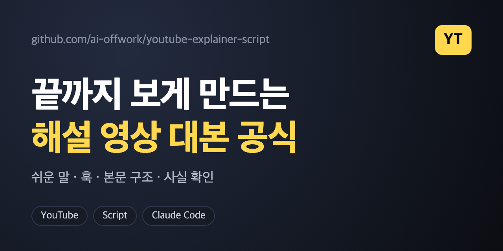

# youtube-explainer-script



해설형 유튜브 롱폼(6~8분) 대본을 쓰기 위한 **Claude Code / 에이전트 스킬**입니다. "일상 속 숨은 이유"를 이야기로 풀어 끝까지 보게 만드는 공식을 담았습니다. 분야는 상관없습니다(과학, 공학, 경제, 역사, 생활).

## 담긴 내용
- 주제를 "친구에게 들려줄 한 문장"으로 바꾸기, 사람·역사 우선
- **쉬운 말 규칙**: 생소한 용어 3개 이내, "가족에게 읽어 줘도 모르는 낱말이 없는가" 점검
- 제목 7가지 질문형 유형, 썸네일 글, **첫 5초 훅**
- 본문 11단계(적 세우기, 시청자 반문, 계단식 반전, 콜백, 그늘, 맺음)
- 끝까지 보게 하는 장치, 문장·말투, **사실 확인 원칙**
- AI 장면 그림·클립 프롬프트 규칙(선택)

## 설치 (Claude Code)
**방법 1. 명령 한 줄** — 모든 프로젝트에서 쓰려면:
```bash
mkdir -p ~/.claude/skills/youtube-explainer-script && curl -fsSL https://raw.githubusercontent.com/ai-offwork/youtube-explainer-script/main/SKILL.md -o ~/.claude/skills/youtube-explainer-script/SKILL.md
```
특정 프로젝트에서만 쓰려면 `~/.claude/skills` 대신 그 프로젝트의 `.claude/skills`에 넣으세요. 설치 후 **새 세션**을 시작하면 인식됩니다.

**방법 2. Claude에게 맡기기** — Claude Code에 이렇게 말하면 파일을 받아 설치해 줍니다(Claude가 파일 받기·쓰기를 허용받은 경우).
> `https://raw.githubusercontent.com/ai-offwork/youtube-explainer-script/main/SKILL.md` 를 `~/.claude/skills/youtube-explainer-script/SKILL.md`로 설치해줘

**방법 3. 직접 복사** — 이 저장소를 받아 `SKILL.md`를 `~/.claude/skills/youtube-explainer-script/`에 넣으면 됩니다.

설치 확인: Claude Code에서 `/youtube-explainer-script`을 입력하거나 "이 주제로 해설 영상 대본 써줘"처럼 요청해 보세요. 다른 에이전트라면 `SKILL.md`를 시스템 프롬프트로 넣으면 됩니다. claude.ai 채팅에서는 설정의 스킬 업로드(zip)를 쓰는 방식이라 메뉴 이름이 바뀔 수 있으니 안내 문서를 확인하세요.

## 쓰는 법
"이 주제로 해설 영상 대본 써줘"라고 요청하면 스킬이 적용됩니다.

## 주의
- 숫자·사건·이름은 직접 확인한 출처만 쓰도록 되어 있습니다. AI가 쓴 대본은 반드시 사실 확인을 거치세요.
- 특정 채널을 베끼지 않고 구조만 가져가세요.

## 만든 곳
인스타 [@ai.offwork.kr](https://www.instagram.com/ai.offwork.kr/) — AI 업무 꿀팁

## 고지
- 개인이 만든 **비공식 프로젝트**이며 Anthropic(Claude, Claude Code), Google(YouTube)과 제휴·후원·승인 관계가 없습니다. 각 이름은 해당 회사의 상표이며, 여기서는 사용 가능한 도구로 언급할 뿐입니다.
- **AI가 쓴 대본·그림은 사람이 검수·편집해서 쓰세요.** 유튜브는 사람의 가공 없이 대량 제작된 반복 콘텐츠("inauthentic content")에 수익화 제재를 하고, 사실적으로 바꾸거나 합성한 콘텐츠는 공개 시 표시하도록 요구합니다. 최신 정책은 유튜브 공식 도움말에서 확인하세요.
- 사실 확인은 사용자의 책임입니다. 다른 채널의 영상·대본을 베끼지 마세요.

## 라이선스
MIT
